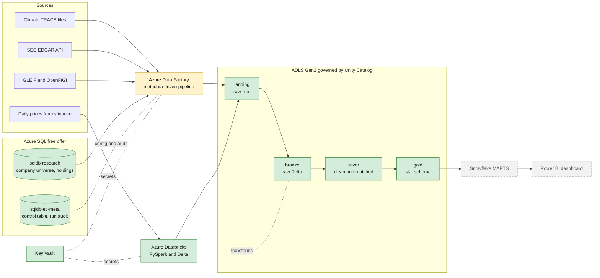

# Carbon vs. Capital

I am building a batch lakehouse on Azure that links independently measured greenhouse gas emissions to US listed companies, so I can ask whether markets price in carbon. Company climate disclosures are self reported and inconsistent. [Climate TRACE](https://climatetrace.org) publishes satellite and model based emissions for individual facilities, together with who owns them. This project joins that data to SEC financials and daily stock prices, and serves the result to a Power BI dashboard through Snowflake.

**Status:** Phase 1 (ingestion) in progress. Phase 0 (setup and exploration) is complete.

## Research questions

1. Which listed companies own the most emissions, in absolute terms and per US dollar of revenue?
2. How does carbon intensity vary by sector, and is it improving year over year?
3. What is the carbon footprint of a sample portfolio, weighted by holdings?
4. Do high emission or worsening emission companies show different returns or volatility than their sector peers? (Descriptive only, not causal and not investment advice.)
5. Where do self reported disclosures, if added later, disagree most with Climate TRACE?

## Architecture

I add to this diagram as each piece is built. Green boxes exist today, the amber box is being built now, and dashed grey boxes are planned.

**What exists today**

* An ADLS Gen2 storage account with `landing`, `bronze`, `silver` and `gold` containers, governed by a Unity Catalog catalog called `carbon_capital`.
* Azure Databricks with Unity Catalog, an access connector (managed identity, no keys) and a Key Vault backed secret scope.
* Azure Key Vault for every secret. Nothing sensitive lives in this repository.
* Azure Data Factory (`adf-carboncap-dev-zm`) with a system assigned managed identity. Pipelines are next.
* Two free Azure SQL databases. `sqldb-research` plays an internal analyst system whose edits change data capture will pick up later. `sqldb-etl-meta` holds the control table that drives ingestion and an audit table with one row per pipeline run.

**How ingestion will work**

One parameterised ADF pipeline reads the enabled rows of the control table, loops over them and calls a small child pipeline for each source type (HTTP files, REST APIs, SQL tables, a Databricks job for prices). Each child opens an audit row, lands raw files in `landing`, and then closes the audit row. The watermark only moves forward after a successful copy, inside the same transaction as the audit update, so a failed run can never skip data. Adding a source means inserting a row, not building a pipeline.

## Roadmap

| Phase | What I build | Status |
|---|---|---|
| 0. Setup and exploration | Azure resource group, ADLS, Key Vault, Databricks with Unity Catalog, Climate TRACE exploration | Done |
| 1. Ingestion | Azure SQL research and metadata databases, metadata driven ADF pipeline for files, APIs and the database | In progress |
| 2. Bronze to silver | Auto Loader, cleaning, units, deduplication, data quality checks and quarantine | Planned |
| 3. CDC and SCD2 | Change data capture from Azure SQL, Delta MERGE with deletes, SCD Type 2 company dimension | Planned |
| 4. Entity resolution | Matching Climate TRACE owners to listed companies, with a labelled evaluation set | Planned |
| 5. Gold | Star schema and carbon metrics | Planned |
| 6. Snowflake and Power BI | Marts, roles, reporting views and a four page dashboard | Planned |
| 7. Production polish | CI/CD with GitHub Actions and Databricks Asset Bundles, alerts, documentation | Planned |

## Data sources

| Source | What it gives me | How it arrives |
|---|---|---|
| Climate TRACE v5.11.0 | Facility emissions by month and facility ownership | Bulk CSV files over HTTP |
| SEC EDGAR | Revenue and other financials, CIK to ticker map | REST API |
| GLEIF and OpenFIGI | Legal entity identifiers, parent companies, identifier to ticker mapping | REST API |
| yfinance | Daily prices | Python job in Databricks |
| Azure SQL research database | Company universe, sample portfolio, analyst overrides | ADF copy, later CDC |

## Repository layout

| Folder | Contents |
|---|---|
| `adf/` | Data Factory pipelines, datasets and linked services (synced from ADF Git mode) |
| `databricks/` | Notebooks and the Python package |
| `sql/azure_sql/` | DDL for the Azure SQL databases, numbered in the order they run |
| `notebooks/exploration/` | Phase 0 exploration of Climate TRACE emissions and ownership |
| `docs/adr/` | Architecture decision records |
| `infra/SETUP_LOG.md` | Every Azure resource I created, with settings, reasons and cost |
| `tests/` | Unit tests |
| `powerbi/` | The Power BI report as a `.pbip` project |

## Key decisions

Each meaningful choice has an architecture decision record in [`docs/adr/`](docs/adr/): the Azure region, how Snowflake is loaded, deferring Terraform to Phase 7, the price source, the company universe rule, the Power BI file format and the Databricks compute strategy.

## Cost

I run this on a personal pay as you go subscription with a $20 monthly budget alert. Storage and Key Vault cost cents, both Azure SQL databases are on the free offer, and Databricks runs on serverless compute only while I use it. The full breakdown will live here when the project is complete.

## Attribution

Emissions data comes from [Climate TRACE](https://climatetrace.org), licensed under CC BY 4.0.
